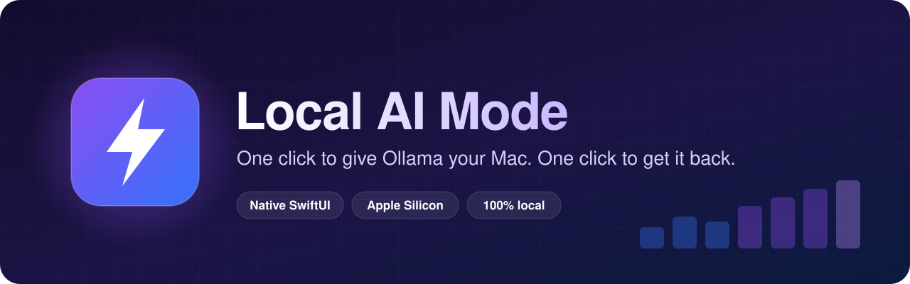
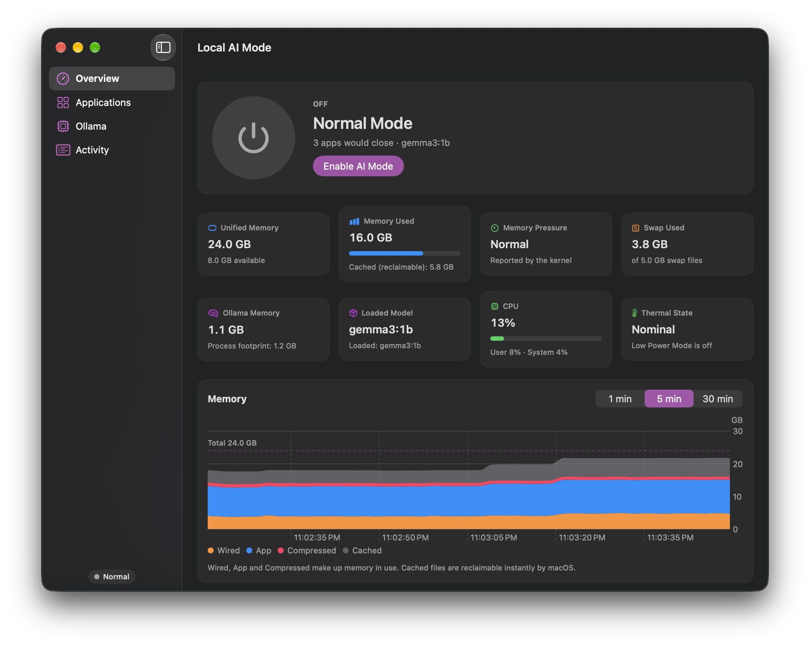
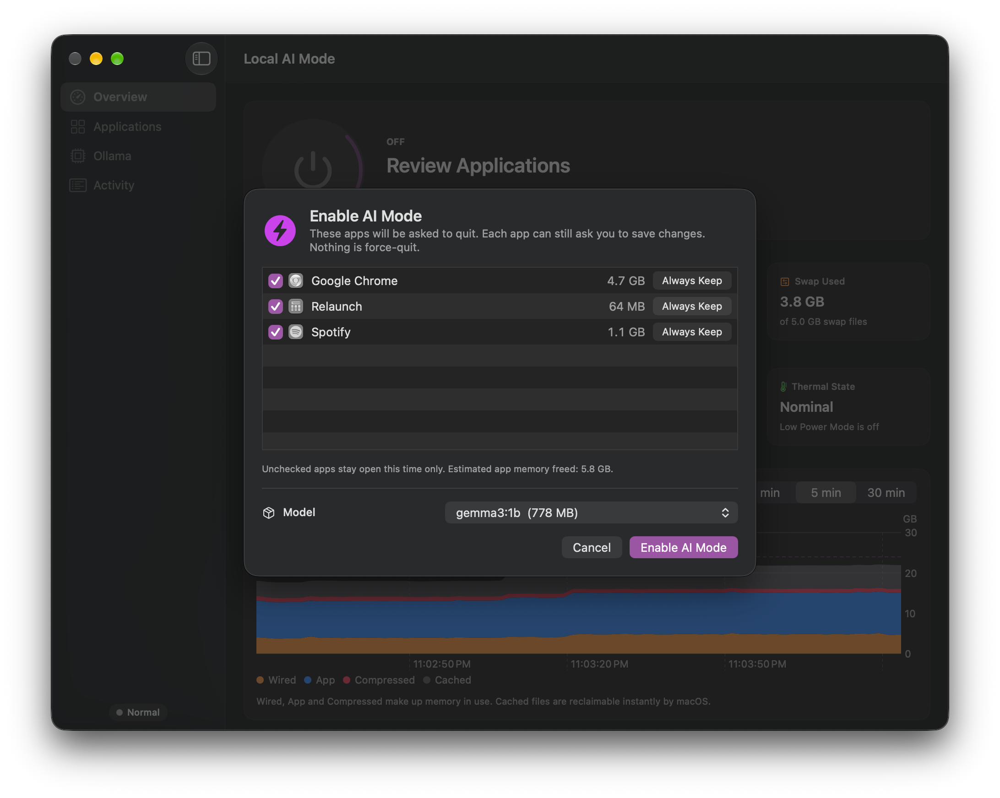
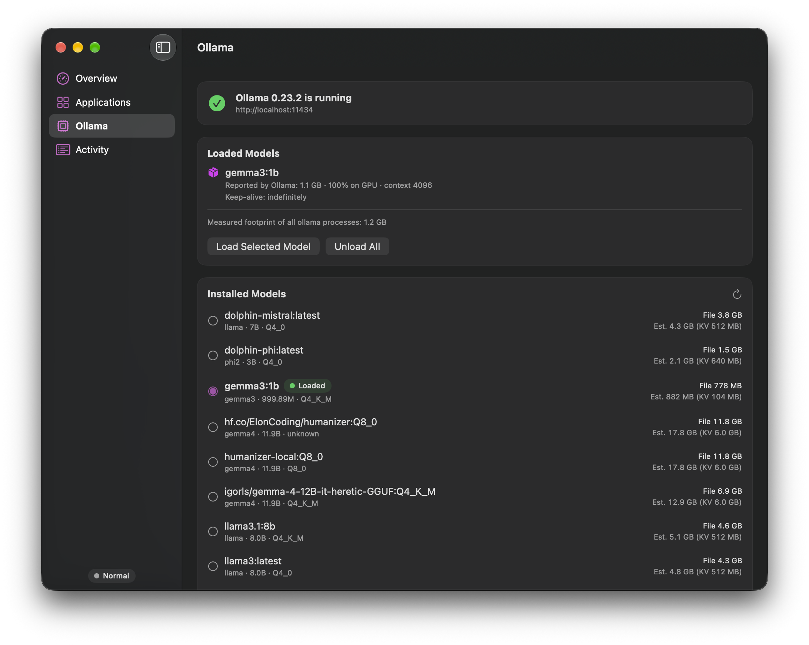
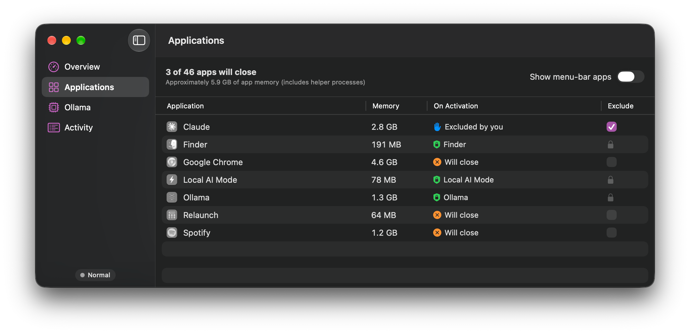
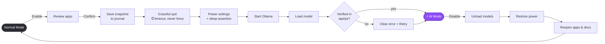

<p align="center">
  
</p>

<p align="center">
  
  
  
  
  
  
</p>

<p align="center">
  <b>Local AI Mode</b> is a native macOS menu-bar utility that frees memory for <a href="https://ollama.com">Ollama</a> with one click,<br>
  then gives your whole workspace back with another.
</p>

<p align="center">
  
</p>

---

## ✨ What it does

<table>
<tr>
<td width="50%" valign="top">

### ⚡ AI Mode ON
1. **Snapshots your workspace**: running apps, hidden state, open documents and browser tabs (optional)
2. **Asks apps to quit gracefully**, so each one can still prompt you to save
3. **Turns off Low Power Mode** (optional, uses the standard macOS password prompt)
4. **Prevents idle sleep** while a model is being served
5. **Starts Ollama** if needed and **loads your model**, then checks `/api/ps` to confirm it really is in memory

</td>
<td width="50%" valign="top">

### 🔄 AI Mode OFF
1. **Unloads models** with `keep_alive: 0`, letting in-flight generations finish first
2. **Confirms the memory was released**
3. **Restores power settings** to exactly what they were
4. **Reopens your apps** in their original order, hidden apps stay hidden, and the app you were using comes back to the front
5. **Reports anything it couldn't restore** (moved or uninstalled apps, deleted documents)

</td>
</tr>
</table>

## 📸 Screenshots

<table>
<tr>
<td width="50%"></td>
<td width="50%"></td>
</tr>
<tr>
<td align="center"><b>Review before anything closes.</b> Untick an app to keep it this time, or choose “Always Keep”.</td>
<td align="center"><b>Real Ollama numbers.</b> Estimated, reported and measured memory are kept clearly separate.</td>
</tr>
<tr>
<td colspan="2"></td>
</tr>
<tr>
<td colspan="2" align="center"><b>Know exactly what happens.</b> Finder, Ollama and system processes are always protected. Claude and Terminal are excluded by default.</td>
</tr>
</table>

## 🧠 How it works



Every step is written atomically to a local **session journal** *before* it happens. If the Mac, the app or Ollama dies halfway through, the next launch offers **Restore Previous Workspace** or **Resume AI Mode**. Nothing closes or changes until you choose.

## 🎯 Honest by design

Local AI Mode only does things that actually free memory, and tells you plainly about the things macOS doesn't allow.

| You might want… | What really happens |
|---|---|
| “Reserve all RAM for Ollama” | macOS has no API for that. AI Mode frees memory by **quitting apps** (the only real lever), then shows a **before/after measurement** so you can see the effect. |
| “Clean my RAM” | ❌ No `purge` or allocation tricks. Cached files are reclaimed by macOS on demand anyway. The dashboard splits **App / Wired / Compressed / Cached / Free** so you can see what's truly in use. |
| Swap & compression | Monitored, **never disabled**. |
| More CPU/GPU for Ollama | No supported API exists. AI Mode removes competing apps and holds an idle-sleep assertion. |
| Thermal limits | Only **observed**. If macOS throttles, the dashboard tells you why. It is never overridden. |
| Force quit | **Never automatic.** Apps that don't quit within the timeout get *Show*, *Wait Longer*, *Keep Open* and a warned *Force Quit…* option. |

<details>
<summary><b>📏 Where every number comes from</b></summary>

| Metric | Source |
|---|---|
| Memory breakdown | `host_statistics64(HOST_VM_INFO64)`, the same definitions Activity Monitor uses |
| Memory pressure | `kern.memorystatus_vm_pressure_level` plus a `DispatchSource` memory-pressure source |
| Swap | `sysctl vm.swapusage` |
| CPU | `host_statistics(HOST_CPU_LOAD_INFO)` tick deltas |
| Per-app memory | `proc_pid_rusage` physical footprint, summed over child processes (browser helpers) |
| Ollama: **Estimated** | model file size plus KV cache computed from `/api/show` metadata |
| Ollama: **Reported** | `size` / `size_vram` from `/api/ps` |
| Ollama: **Measured** | physical footprint of every `ollama` process |

Sampling runs every **2 s** while the dashboard or menu-bar panel is open and every **15 s** otherwise. Per-process statistics are only collected while a window is visible, or while AI Mode is on.

</details>

<details>
<summary><b>🦙 Ollama integration</b> (documented HTTP API only)</summary>

- `GET /api/version`, `/api/tags`, `/api/ps` · `POST /api/show`
- **Load:** `POST /api/generate` with an empty prompt, `keep_alive` (−1 means indefinitely) and `options.num_ctx`. A model counts as loaded only once `/api/ps` lists it.
- **Unload:** `keep_alive: 0` for each loaded model, then `/api/ps` is polled until the model is gone. Anything still resident is reported.
- **Server settings:** run as `ollama serve` to apply `OLLAMA_NUM_PARALLEL`, `OLLAMA_MAX_LOADED_MODELS`, `OLLAMA_FLASH_ATTENTION`, `OLLAMA_KV_CACHE_TYPE` and `OLLAMA_CONTEXT_LENGTH` (**Restart Ollama with These Settings**).
- **Keep Ollama running after exiting AI Mode** is a setting. Only Ollama.app or the app's own `ollama serve` is ever stopped, and model files are never touched.
- Handles: not installed · installed but stopped · API unreachable · model not found · insufficient memory · runner crash · Ollama quit mid-session · model evicted.

</details>

<details>
<summary><b>🛟 Crash recovery & restore details</b></summary>

- Journal: `~/Library/Application Support/LocalAIMode/session-journal.json` (mode `0600`, atomic writes).
- A new session **refuses to overwrite** an existing journal. *Resume* adds newly opened apps to the original snapshot instead of replacing it.
- **Emergency Workspace Restore** (Settings › Recovery) works from the current journal or the last finished session.
- A damaged journal is moved aside, never silently deleted.
- **Moved apps** are found again by bundle identifier. **Uninstalled apps** and **deleted documents** are listed in the report.
- Browser tabs are reopened only if the browser comes back with **no windows**, so you never get duplicates.
- Apps opened *during* AI Mode are listed with a Quit button and never closed automatically.
- An app hosting the Ollama server (for example a Terminal running `ollama serve`) is detected through the process tree and protected.

</details>

## 🚀 Getting started

**Requirements:** an Apple Silicon Mac, macOS 15 or later, Xcode 16 or later, and [Ollama](https://ollama.com/download) with at least one model pulled.

```bash
git clone https://github.com/pipelinear/local-ai-mode.git
```

```bash
cd local-ai-mode && open LocalAIMode.xcodeproj
```

Press **⌘R**. Or build a Release app from the command line:

```bash
xcodebuild -project LocalAIMode.xcodeproj -scheme LocalAIMode -configuration Release -derivedDataPath build/DerivedData build
```

```bash
open "build/DerivedData/Build/Products/Release/Local AI Mode.app"
```

Copy `Local AI Mode.app` to `/Applications` to keep it. The app is ad-hoc signed; set your own team under *Signing & Capabilities* to distribute it.

### Using it

1. Pick a model in the **Ollama** panel and adjust keep-alive and context size if you like.
2. In **Applications**, tick **Exclude** for anything that must stay open.
3. Hit the big power button, the menu-bar icon or **⇧⌘E**.
4. Hit it again to get everything back.

## 🔐 Permissions

| Permission | Used for | If you say no |
|---|---|---|
| *(none)* | Listing and quitting apps, metrics, Ollama, restore | — |
| Admin password, per change | Turning Low Power Mode off and back on | Low Power Mode is left alone |
| Accessibility *(optional)* | Recording which documents are open per window | Apps use their own window restoration |
| Automation *(optional, off by default)* | Recording browser tabs | Browsers use their own session restore |
| Login Items | Launch at Login (`SMAppService`) | Approve it in System Settings |

No root helper, no private APIs, and SIP stays on. The app isn't sandboxed, because the App Sandbox can't quit other apps. It uses the Hardened Runtime with only the Apple Events entitlement. **Nothing is ever sent off your Mac.**

## 🧪 Tests

```bash
xcodebuild -project LocalAIMode.xcodeproj -scheme LocalAIMode -derivedDataPath build/DerivedData test
```

57 XCTest cases cover: which apps may close · snapshot and journal serialization · crash recovery (including corrupt journals and never overwriting the snapshot) · mode-transition rules (overlapping ON/OFF requests are rejected) · Ollama request construction and error handling, using a mock `URLProtocol` · restore planning for moved or uninstalled apps · `pmset` parsing · default exclusions.

## 🗂 Project layout

```
LocalAIMode/
├─ App/LocalAIModeApp.swift          App scenes: dashboard, Settings, MenuBarExtra
├─ Core/
│  ├─ Models.swift                   Snapshot, journal, samples, state enums
│  ├─ ModeStateMachine.swift         Pure transition rules
│  └─ ModeController.swift           Orchestrates ON/OFF, recovery, activity log
├─ Services/
│  ├─ ApplicationManager.swift       NSWorkspace listing, graceful/force quit
│  ├─ ExclusionPolicy.swift          Which apps may close
│  ├─ WorkspaceManager.swift         Snapshot capture, restore planner, AX + Apple Events
│  ├─ OllamaClient.swift             HTTP client, API types, errors, memory estimate
│  ├─ OllamaService.swift            Observable Ollama state, launcher, load/verify/unload
│  ├─ MemoryMonitor.swift            Mach/sysctl metrics, adaptive sampling
│  ├─ ProcessInspector.swift         libproc footprints & process tree
│  ├─ PerformanceManager.swift       pmset parsing, privileged change, sleep assertion
│  ├─ SessionManager.swift           Atomic journal store, recovery assessment
│  └─ SettingsManager.swift          Preferences, launch at login, default exclusions
└─ UI/                               Dashboard, panels, chart, menu bar, settings, recovery
LocalAIModeTests/                    57 XCTest cases
project.yml                          XcodeGen spec (the .xcodeproj is committed too)
```

## ⚠️ Known limitations

- Whether an app reopens its windows depends on the app. Window positions and unsaved state can't be recreated by a third party.
- Changing Low Power Mode needs a password prompt each way, because macOS has no unprivileged API for it.
- *Estimated* model memory is approximate. Trust the *Reported* figure from Ollama once the model is loaded.
- Apart from Claude and Terminal, the app **will** offer to quit other terminals, editors and chat apps (iTerm, Cursor, VS Code…). Exclude the ones you need.

<p align="center"><sub>Built with Swift, SwiftUI, AppKit and Swift Charts. No Electron, no cloud, no subscriptions.</sub></p>
